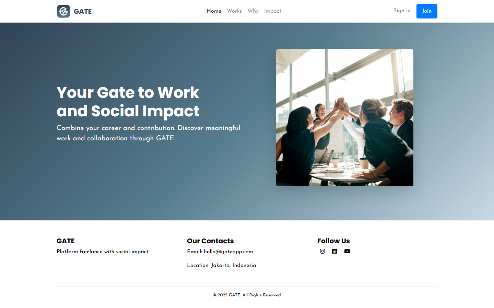

# GATE — Freelance & Social Impact

**GATE** adalah prototipe website platform freelance dengan dampak sosial: menghubungkan *freelancer*, *employer*, dan *foundation* (yayasan) dalam satu tempat. Pekerjaan dan transaksi di platform diarahkan untuk mendukung donasi ke lembaga amal terverifikasi.

> Status: prototipe front-end statis (tugas UTS). Belum ada backend; semua interaksi disimulasikan di sisi klien.

## Preview



## Fitur

- **Halaman publik:** Home, Works, Why, Impact, Sign In, dan Sign Up (pilih peran).
- **Freelancer:** feed lowongan, daftar pekerjaan, profil dan edit profil, chat, GATE Pay, review.
- **Employer:** posting pekerjaan, profil dan edit profil, chat, GATE Pay, review.
- **Foundation:** feed, posting kegiatan/donasi, profil dan edit profil, GATE Pay.
- **Interaksi (jQuery):** animasi fade-in, simulasi pengiriman OTP, tabel yang bisa diurutkan, dan chat sederhana.

## Teknologi

- HTML5 dan CSS3
- [Bootstrap 4.3.1](https://getbootstrap.com/docs/4.3/) (sudah disertakan di `bootstrap-4.3.1-dist/`)
- JavaScript dan jQuery

## Struktur Proyek

```
GATE_PROJECT/
├── home.html, why.html, works.html, impact.html   # halaman publik
├── signin.html, signup.html                       # masuk dan daftar
├── employer/                                      # halaman untuk employer
├── freelancer/                                    # halaman untuk freelancer
├── foundation/                                    # halaman untuk foundation
├── js/register.js                                 # logika pendaftaran berdasarkan peran
├── scripts.js                                     # interaksi umum (OTP, sorting, chat)
├── global.css, home.css                           # styling global dan halaman utama
├── asset/                                         # gambar dan logo
└── bootstrap-4.3.1-dist/                          # Bootstrap
```

## Menjalankan Secara Lokal

Tidak perlu instalasi apa pun.

```bash
git clone https://github.com/amaliacalista26/GATE_PROJECT.git
cd GATE_PROJECT
```

Lalu buka `home.html` di browser, atau jalankan server lokal:

```bash
python -m http.server 8000
# buka http://localhost:8000/home.html
```

## Berkontribusi

1. Fork repositori ini.
2. Buat branch baru: `git checkout -b fitur/nama-fitur`
3. Commit perubahan dengan pesan yang jelas.
4. Push ke fork kamu dan buka Pull Request.

## Kontak

Jakarta, Indonesia
